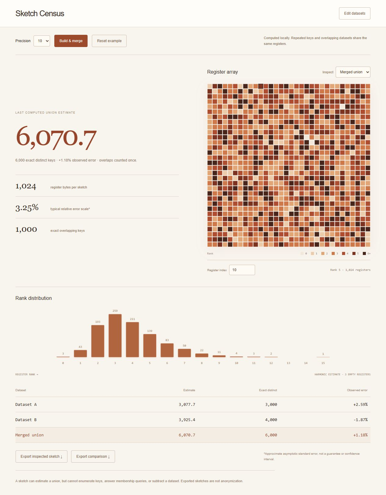

# Sketch Census

A HyperLogLog workbench for approximate distinct counting. Build compact sketches from two datasets, merge their registers, inspect the estimator, and compare the result with exact reference counts.



## Run

```sh
python run.py --port 8000
```

Open http://127.0.0.1:8000. Python 3.10+ serves static assets; computation runs in a browser worker using Web Crypto. No runtime packages, accounts, or remote API are required. Node 22+ is used for tests.

The default example contains `visitor-0` through `visitor-2999` in A and `visitor-2000` through `visitor-5999` in B. At precision 10, each sketch has 1,024 register bytes. The merged estimate is 6,070.7021 versus exactly 6,000 distinct keys: +1.18% observed error. The overlapping 1,000 keys contribute to both inputs but are naturally deduplicated in the union.

The register heatmap displays every stored rank, with darker cells for higher ranks (6 and above share the darkest color). Select a cell or use the register index field to read its exact rank. Dataset selection updates both the array and histogram. The union estimate and reference counts remain separate from the inspected dataset. Bar growth and map fades respect reduced-motion preferences. Raw inputs open in an editing dialog.

## Features

- SHA-256 hashing, 64-bit bucket/rank extraction, harmonic estimation, small-cardinality linear counting, and an explicit saturation result.
- Register-wise maximum merging: associative, commutative, and idempotent, with no double-counting of overlapping input identities.
- Precision 4–14, rank histograms, side-by-side reference counts, and observed error.
- A worker keeps hashing off the UI thread. Input edits invalidate exports until the next successful computation.
- Checksummed portable sketches for A, B, or the union. Import a sketch as B and merge it with new raw input.
- Explicit unknown exact counts after import; neither overlap nor union truth can be reconstructed from registers.

## Algorithm and reproducibility

Each key is encoded as UTF-8 `JSON.stringify(["sketch-census-v1", key])`, hashed with SHA-256, and truncated to its first eight bytes in big-endian order. The first `p` bits select a register; the remaining `64-p` bits determine the position of their first one, starting at 1. An all-zero suffix has rank `65-p`. Registers start at zero and retain the maximum rank observed.

For `m = 2^p`, the raw estimator is `alpha * m² / sum(2^-register)`, with alpha 0.673, 0.697, 0.709 for m=16,32,64 and `0.7213/(1+1.079/m)` otherwise. When raw ≤ 2.5m and empty registers remain, the estimate is `m * log(m/empty)`. For raw > 2^64/30, a finite-hash correction uses `-2^64 * log1p(-raw/2^64)`; raw ≥ 2^64 returns `null` and a saturation label. Large-range behavior is a finite-space convention for imported/synthetic sketches, not validated at enormous real-world cardinalities.

The algorithm follows the harmonic estimator and small-range approach in [Flajolet, Fusy, Gandouet, and Meunier's HyperLogLog paper](https://algo.inria.fr/flajolet/Publications/FlFuGaMe07.pdf), using 64-bit hashes here. The displayed `1.04/sqrt(m)` is an approximate asymptotic standard-error scale under uniform-hash assumptions. It is not an error bound, confidence interval, or guarantee for a particular dataset. This is not HLL++, and does not implement empirical bias tables, sparse encoding, or precision downsampling.

## Input and file semantics

Each nonempty line is one key. CRLF, LF, and CR separate lines. Blank lines are ignored. Leading/trailing spaces and Unicode normalization differences are preserved. Keys have at most 128 UTF-16 code units; controls and unpaired surrogates are rejected. Each dataset is bounded to 20,000 lines and one million UTF-16 units.

Sketch JSON contains exactly `format`, `hash`, `p`, `registers`, and `checksum`. The SHA-256 checksum covers compact JSON of the first four fields in that order. Registers are stored as a JSON integer array, so exported file size exceeds the byte-array memory reported in the UI. Imports accept up to 200 KB, validate every register and the hash convention, and lock precision to match B. Reset the example to return to raw datasets.

Comparison exports contain summary statistics and all three sketches, but no original keys. Raw-input reference sets and input strings are retained in browser memory for comparison: **the app's total memory use is not limited to the register byte count**. A production streaming implementation would omit those reference sets.

Checksums detect accidental corruption, not malicious edits. Sketches are not encrypted, authenticated, or anonymized; guessed inputs can affect known registers. They cannot list keys, support exact membership, estimate intersection reliably by subtraction, or remove items. The UI does not claim those capabilities. Closing the page loses its raw inputs; save an export if needed.

## Verification

```sh
node --test
npm run check
python -m unittest discover -s tests -v
```

Nine JavaScript tests cover 3,300 independent bit-string bucket/rank comparisons, SHA-256 agreement with Node's hash implementation, duplicate invariance, direct-union equivalence, merge algebra, correction/saturation branches, checksum validation, strict input limits, and loss of reference knowledge after import. The Python server test verifies the asset allowlist, HEAD handling, and Host restrictions. GitHub Actions runs Node 22/24 on Linux and Node 24 on Windows.

Browser verification covered precision changes, stale-export protection, saved-sketch import, unknown reference labels, invalid input recovery, and both export types. A separate Python implementation recomputed all 3,072 default registers, all three estimates, and all three checksums from the original example key ranges. The one deterministic accuracy smoke test is a regression fixture, not a statistical validation study.
